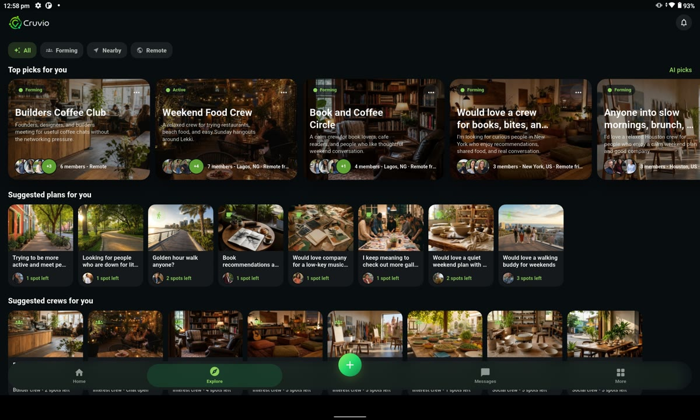

# Cruvio

**Social discovery that helps people make real plans**

Cruvio is a social-discovery product for people who want to meet others through shared interests and small group activities. It is shaped for moments such as moving to a new city, starting campus life, or looking for a new community.

Instead of building an endless public feed, Cruvio organizes discovery around opportunities to do something together. It helps people move from a compatible interest to a specific plan, a group, or a local event.

## Three ways to connect

- **Plans** are short-term activities such as trying a restaurant, walking, studying, or visiting a gallery.
- **Crews** are ongoing circles formed around shared interests, goals, or life situations.
- **Events** are local experiences hosted by verified businesses.

Each type has its own participation flow and conversation context. A person can express interest in a plan or request to join a crew; the organizer reviews requests and capacity before participation is confirmed. Accepted members can then coordinate in the relevant group conversation.

## Discovery and trust

Discovery is country-first, with remote and hybrid options where appropriate. The product uses availability, interests, and profile details to help people find relevant crews and plans. The interaction model makes participation states visible, including pending requests, acceptance, full capacity, leaving, and reopened spaces.

Safety is part of the flow. Cruvio includes reporting and blocking, keeps sensitive meeting details protected until appropriate, and ties group conversations to the relevant plan or crew. AI-assisted features support profile understanding, matching, moderation, group proposals, recaps, and in-app guidance while keeping the product focused on real-world connection.

Cruvio is intentionally different from a dating app, follower graph, public attendee list, or open direct-message network. The product gives organizers clear control over who joins and when a group conversation becomes available.

## Explore screen

  

Application capture using deterministic sample community content.

## Engineering

Cruvio combines a Flutter mobile app with a companion web experience. Supabase-backed data and server workflows support profiles, discovery, group participation, and messaging. The project includes backend functions, scheduled or event-driven work, and regression checks across the user journeys that span the app and backend.

The implementation keeps interface code focused on presentation while providers, controllers, repositories, server functions, and background tasks handle their respective responsibilities. Database access and trusted writes follow separate paths, and empty states are intended to reflect real available content rather than invented activity.

## Technology

Flutter and Dart, Supabase, PostgreSQL, web APIs, background tasks, and automated workflow checks.

## Try Cruvio

- [Watch the product demo](https://youtu.be/UjEGxzgWZhk)
- [Visit the main site](https://cruvio.live)
- [Download on the App Store](https://apps.apple.com/us/app/cruvio-find-your-crew/id6774282379)
- [Get it on Google Play](https://play.google.com/store/apps/details?id=com.cruvio.acenetics)
- [View the public case study](https://acenetics.dev/work)

## This repository

This is a public project overview and interface capture. It does not contain private source code, user data, credentials, or internal operating details.
